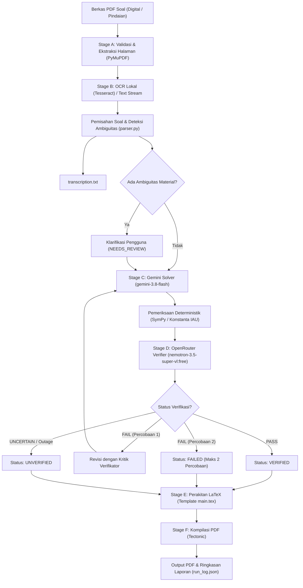

# 🪐 Automated Exam Solver (Solusi Soal Ujian Otomatis)

Sistem penyelesaian soal ujian otomatis berbasis **Jupyter Notebook** yang dirancang khusus untuk mahasiswa tingkat sarjana **Astronomi, Fisika, dan Matematika**.

Proyek ini mengotomatiskan alur kerja mulai dari pembacaan lembar soal (PDF digital maupun hasil pemindaian/foto), transkripsi soal, penurunan rumus matematis dengan **Google Gemini (`gemini-3.8-flash`)**, verifikasi independen dengan **OpenRouter (`nvidia/nemotron-3.5-super-vl:free`)**, pemeriksaan deterministik berbasis **SymPy**, perakitan dokumen **LaTeX** yang mempertahankan template asli `main.tex`, hingga kompilasi **PDF** siap cetak.

---

## 🌟 Arsitektur & Alur Kerja



---

## 📋 Fitur Utama

1. **Pemrosesan PDF Digital & Gambar**:
   - Mendukung PDF digital (vektor teks) maupun PDF gambar hasil foto/pindaian menggunakan Tesseract OCR lokal tanpa biaya API eksternal.
2. **Penyelesaian Berstandar Ilmiah**:
   - Google Gemini (`gemini-3.8-flash`) menghasilkan penurunan matematis bertahap, eksplisit dengan analisis dimensi dan satuan fisika.
3. **Verifikasi Independen**:
   - Model peninjau kedua via OpenRouter (`nvidia/nemotron-3.5-super-vl:free`) mengevaluasi akurasi rumus, aljabar, dan asumsi secara terpisah.
4. **Pemeriksaan Deterministik SymPy**:
   - Verifikasi perhitungan numerik dan substitusi konstanta astronomi/fisika (CODATA / IAU standard) dilakukan secara lokal tanpa membakar kuota model AI.
5. **Batas Ketat 2 Kali Percobaan**:
   - Maksimal 1 solusi awal dan 1 revisi perbaikan jika verifikasi gagal. Mencegah perulangan tanpa batas.
6. **Preservasi Template LaTeX `main.tex`**:
   - Mempertahankan seluruh preamble, font (`baskervald`, `stix2`), lingkungan kotak (`tcolorbox`, `mdframed`, `empheq`), dan tata letak asli. Hanya bagian `{problem}`, `{solution}`, dan identitas ujian yang diisi.
7. **Penyimpanan Atomik & Pemulihan (Checkpoint & Resumption)**:
   - Setiap kemajuan soal disimpan secara atomik di `jobs/<job_id>/state.json`. Pekerjaan yang terhenti karena kuota habis atau kernel mati dapat dilanjutkan langsung dari titik terakhir tanpa mengulang soal yang telah berstatus `VERIFIED`.

---

## 🛠️ Persyaratan Sistem

- **Sistem Operasi**: Windows 10/11 (atau Linux/macOS)
- **Python**: Python 3.10+ (teruji hingga Python 3.15)
- **LaTeX Compiler**: [Tectonic](https://tectonic-typesetting.github.io/) (direkomendasikan, mandiri dan mengunduh paket secara otomatis) atau TeX Live / MiKTeX.
- **OCR Engine**: [Tesseract OCR](https://github.com/UB-Mannheim/tesseract/wiki) (termasuk model bahasa `eng` dan `ind`).

---

## 🚀 Instalasi & Konfigurasi

### 1. Klon Repositori & Masuk ke Direktori
```bash
cd c:\solusi-soal-ujian
```

### 2. Pasang Dependensi Python
```bash
python -m pip install -r requirements.txt
```

### 3. Konfigurasi Kunci API (`.env`)
Salin berkas `.env.example` menjadi `.env`:
```bash
copy .env.example .env
```
Buka `.env` dan masukkan kunci API Anda:
```env
# Google Gemini API Key (Solver)
GEMINI_API_KEY=AIzaSy...

# OpenRouter API Key (Verifier)
OPENROUTER_API_KEY=sk-or-v1-...

# Model Default (Terverifikasi & Gratis/Standard)
GEMINI_MODEL=gemini-3.8-flash
OPENROUTER_MODEL=nvidia/nemotron-3.5-super-vl:free
```
> **Keamanan Kredensial**: Berkas `.env` telah tercatat di `.gitignore` dan tidak akan terunggah ke repositori git. Kunci API tidak pernah ditampilkan dalam keluaran log atau notebook (selalu di-mask).

---

## 📖 Cara Penggunaan

### Menggunakan Jupyter Notebook (Direkomendasikan)
1. Buka Jupyter Notebook:
   ```bash
   jupyter notebook exam_solver.ipynb
   ```
2. Jalankan cell secara berurutan:
   - **Cell 1–2**: Memeriksa pustaka, Tesseract, Tectonic, dan kunci API.
   - **Cell 3**: Memilih berkas PDF ujian (tersedia contoh di `sample_exams/sample_exam_astronomy.pdf`).
   - **Cell 4**: Menjalankan OCR lokal dan membuat `transcription.txt`.
   - **Cell 5**: Meninjau ambiguitas (jika ada soal bertanda `NEEDS_REVIEW`).
   - **Cell 6–7**: Menyelesaikan soal dengan Gemini dan memverifikasi dengan OpenRouter.
   - **Cell 8–9**: Merakit dokumen LaTeX dan mengompilasi PDF akhir.
   - **Cell 10**: Melihat ringkasan eksekusi, log pemanggilan API, dan status pekerjaan.

### Menjalankan via Skrip Python Mandiri
Anda juga dapat mengeksekusi secara otomatis dari baris perintah:
```python
from exam_solver.workflow import execute_job

summary = execute_job(
    pdf_path="sample_exams/sample_exam_astronomy.pdf",
    exam_metadata={
        "exam_type_year": "UTS 2024",
        "course_name": "AS2001 - Astrofisika",
        "semester": "Semester Ganjil"
    }
)
print("Ringkasan:", summary)
```

---

## 📁 Struktur Berkas Proyek

```
solusi-soal-ujian/
├── main.tex                    # Template LaTeX utama yang dilindungi
├── exam_solver.ipynb           # Jupyter Notebook interaktif utama
├── requirements.txt            # Daftar dependensi Python
├── .env.example                # Contoh konfigurasi kredensial aman
├── .gitignore                  # Pengecualian berkas rahasia dan kerja
├── exam_solver/                # Modul inti Python
│   ├── __init__.py
│   ├── config.py               # Pemuatan .env, masking kunci, pendeteksian alat
│   ├── state.py                # Skema status atomik, checkpointing, resumption
│   ├── ocr.py                  # PyMuPDF rendering & Tesseract OCR lokal
│   ├── parser.py               # Pemisahan soal, deteksi ambiguitas, transkripsi
│   ├── math_checks.py          # Pemeriksaan numerik SymPy & konstanta astronomi
│   ├── solver.py               # Google Gemini client (gemini-3.8-flash)
│   ├── verifier.py             # OpenRouter client (nemotron-3.5-super-vl:free)
│   ├── latex_engine.py         # Perakitan template LaTeX & kompilasi Tectonic
│   └── workflow.py             # Orkestrasi lengkap end-to-end
├── tests/                      # Rangkaian pengujian otomatis
│   ├── test_latex_template.py  # Uji template LaTeX dan kompilasi
│   ├── test_parser.py          # Uji pemisahan soal dan ambiguitas
│   ├── test_verifier_json.py   # Uji validasi respons JSON verifikator
│   ├── test_workflow_mocks.py  # Uji batas 2 percobaan, mock kuota, resumption
│   └── test_security.py        # Uji keamanan kredensial dan .gitignore
├── sample_exams/               # Berkas PDF contoh untuk pengujian
│   ├── sample_exam_astronomy.pdf  # PDF digital
│   └── sample_scanned_exam.pdf    # PDF pindaian murni (uji OCR Tesseract)
└── jobs/                       # Direktori kerja hasil pemrosesan ujian
    └── <job_id>/
        ├── state.json          # Checkpoint status atomik
        ├── run_log.json        # Log rinci setiap tahapan
        ├── raw_ocr.txt         # Hasil mentah OCR sebelum parsing
        ├── transcription.txt   # Transkripsi rapi seluruh soal
        ├── <job_id>.tex        # Berkas LaTeX lengkap yang dirakit
        ├── <job_id>.pdf        # Berkas PDF hasil kompilasi
        ├── extracted_pages/    # Gambar halaman PDF yang dirender
        └── questions/          # Status dan catatan per soal
```

---

## 🧪 Pengujian Otomatis

Seluruh pengujian unit dan integrasi dapat dijalankan tanpa membakar kuota API:
```bash
python -m pytest tests/ -v
```

Hasil uji mencakup:
- ✅ Preservasi preamble dan struktur template `main.tex`.
- ✅ Penggantian terkontrol hanya pada placeholder yang diizinkan.
- ✅ Kompilasi LaTeX nyata menghasilkan PDF yang valid.
- ✅ Penanganan kegagalan kompilasi tanpa program berhenti (*crash*).
- ✅ Pemisahan soal bertahap berdasarkan nomor urut dan Course Outcome (`[CO X]`).
- ✅ Deteksi ambiguitas dan simbol tidak terbaca.
- ✅ Batas ketat 2 kali percobaan solusi per soal.
- ✅ Pemulihan (*resumption*) setelah gangguan tanpa pemanggilan API ulang untuk soal yang selesai.
- ✅ Penanganan batas kuota (HTTP 429) dan *timeout* jaringan dengan *bounded backoff*.
- ✅ Keamanan kunci API dan pencegahan kebocoran kredensial.

---

## 📌 Catatan & Batasan

1. **Model Gratis & Batasan Kuota**:
   - Model OpenRouter `nvidia/nemotron-3.5-super-vl:free` merupakan layanan gratis komunitas tanpa jaminan SLA. Jika layanan verifikator mengalami *outage* atau antrean penuh, status verifikasi akan dicatat sebagai `UNVERIFIED` secara transparan dan tidak pernah dipalsukan sebagai `PASS`.
2. **Kualitas OCR pada Tulisan Tangan**:
   - Tesseract OCR bekerja optimal pada teks cetak/ketikan komputer. Untuk lembar soal dengan tulisan tangan yang sangat kursif atau buram, peninjauan manual pada tahap transkripsi sangat disarankan melalui `transcription.txt` atau bagian `NEEDS_REVIEW`.
